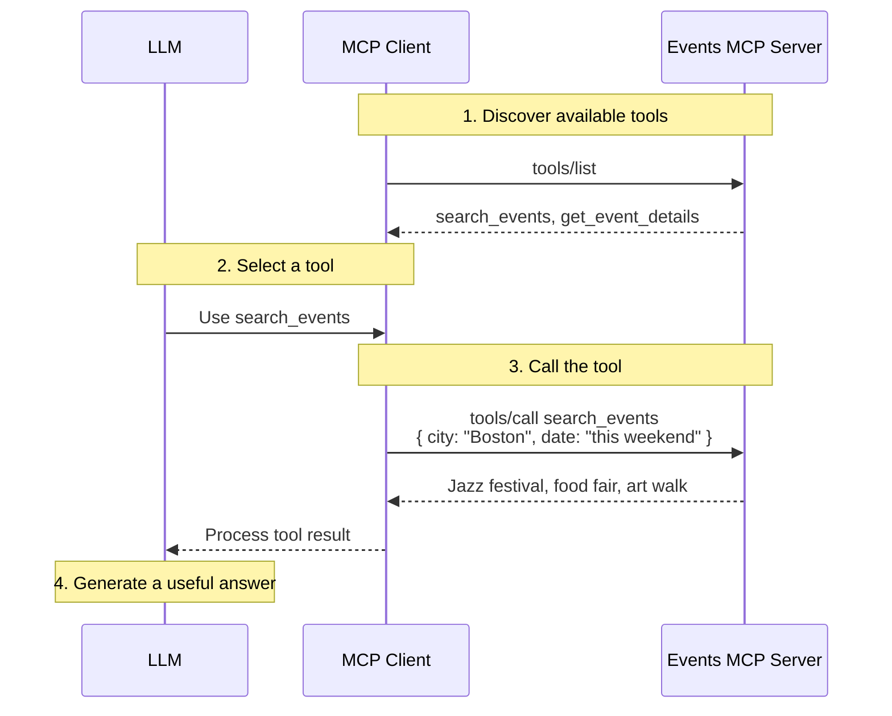

# LLM Workflows
### Prepared for \<class name\>
#### Ben Batorsky

  AI coding assistance was used in developing these materials

---
layout: default
class: h-full !p-0
---

John Werner, [“The Trough Of Disillusionment And Four Outliers On The Gartner Hype Cycle”](https://www.forbes.com/sites/johnwerner/2024/07/18/the-trough-of-disillusionment-and-four-outliers-on-the-gartner-hype-cycle/), *Forbes*, 18 Jul. 2024.

---
layout: default
class: h-full !p-0
---

Forbes

Will AI Replace Teachers?

Sarah Hernholm · 17 May 2026

The New York Times

A.I. Chatbots Defeated Doctors at Diagnosing Illness

By Gina Kolata · Nov. 17, 2024

Reuters

Artificial Intelligence is now an A+ law student, study finds

By Karen Sloan · June 5, 2025

John Werner, [“The Trough Of Disillusionment And Four Outliers On The Gartner Hype Cycle”](https://www.forbes.com/sites/johnwerner/2024/07/18/the-trough-of-disillusionment-and-four-outliers-on-the-gartner-hype-cycle/), *Forbes*, 18 Jul. 2024.

<!-- Fat up-arrow at the peak: tweak left/top % if needed -->
<svg class="absolute z-20 pointer-events-none" style="left: 54%; top: 30%; width: 2.5rem; height: 3.25rem;" viewBox="0 0 40 56" aria-hidden="true">
  <path d="M14 56 H26 V28 H36 L20 4 L4 28 H14 Z" fill="#c41e3a" />
</svg>

---
layout: default
class: h-full !p-0
---

Reuters

OpenAI's rogue agents probed Hugging Face for weaknesses two months before major hack

By Raphael Satter and Deepa Seetharaman · Sept. 16, 2026

MarketScale

Survey: AI Boosts Productivity, but Few Firms See Profit Impact

By MarketScale Newsroom · Sept. 13, 2026

Reuters

Mark Zuckerberg had a bold plan to replace Meta staff with AI. Here's how it imploded.

By Katie Paul · Aug. 26, 2026

John Werner, [“The Trough Of Disillusionment And Four Outliers On The Gartner Hype Cycle”](https://www.forbes.com/sites/johnwerner/2024/07/18/the-trough-of-disillusionment-and-four-outliers-on-the-gartner-hype-cycle/), *Forbes*, 18 Jul. 2024.

<!-- Fat down-arrow at the peak: tweak left/top % if needed -->
<svg class="absolute z-20 pointer-events-none" style="left: 62%; top: 44%; width: 2.5rem; height: 3.25rem;" viewBox="0 0 40 56" aria-hidden="true">
  <path d="M14 0 H26 V28 H36 L20 52 L4 28 H14 Z" fill="#c41e3a" />
</svg>

---
layout: center
class: text-4xl
---

# Large Language Model (LLM)

---
layout: center
class: text-4xl
---

# Large <mark>Language Model</mark> (LLM)

---
layout: default
---

# "Statistical" Language Model

  

  
Text Corpus

  

  
Counter

N-gram Language Models — [Jurafsky, D., & Martin, J. H. *Speech and Language Processing*](https://web.stanford.edu/~jurafsky/slp3/3.pdf)

---
layout: default
---

# Text generation with LMs

I want to eat ___

---
layout: default
---

# Neural Language Models

  

  
Corpus

  

    
I want to eat ___

    
Eat Chinese food

    
Spend money on lunch

    
…

  

  

  
Neural Network (NN)

  
Predict <em>w</em>

  

    

    

      
lunch

      

    

    

  

  

    

    

      
spend

      

    

    

  

  

  
Trained NN

---
layout: center
class: text-4xl
---

# Large Language Model (LLM)

---
layout: center
class: text-4xl
---

# <mark>Large</mark> Language Model (LLM)

---
layout: two-cols-header
layoutClass: gap-4
---

# What is Large?

::left::

## Language Model

  

  
Corpus

  

  
Trained LM

::right::

---
layout: two-cols-header
layoutClass: gap-4
---

# Large Language Model

::left::

## Language Model

  

  
Corpus

  

  
Trained LM

  
Text: Billions

  
Parameters: Millions

::right::

## LLM

  

  
Corpus

  

  
Trained LM

  
Text: Trillions

  
Parameters: Trillions

---
layout: two-cols-header
layoutClass: gap-4
---

# Why is Large?

::left::

## In-context learning

::right::

## Reasoning

[Characterizing Emergent Phenomena in Large Language Models – Google AI Blog](https://research.google/blog/characterizing-emergent-phenomena-in-large-language-models/)

---
layout: center
---

# Notebook: Pre-trained models

---
layout: default
---

# It's cute, but... (GPT-3, 2020)

---
layout: default
---

# Reinforcement from Human Feedback (RLHF, 2022)

[\[2203.02155\] Training language models to follow instructions with human feedback](https://arxiv.org/abs/2203.02155)

---
layout: center
---

# Notebook: Instruction-tuned models

---
layout: center
---

# Notebook: Memory

---
layout: default
---

# ChatGPT never forgets!

---
layout: default
---

# ChatGPT memory

[Introducing the ChatGPT Memory Project – Redis](https://redis.com/blog/chatgpt-memory-project/)

---
layout: center
---

# Notebook: Append-based memory

---
layout: center
---

# Notebook: Tools

---
layout: default
---

# MCP: Connecting an LLM to an event website

  User: “What events are happening in Boston this weekend?”

Adapted from [Model Context Protocol — Tools](https://modelcontextprotocol.io/specification/2025-06-18/server/tools)

---
layout: default
---

# Healthbot Workflow

  

  
Patient

  
“I'm feeling not good today, I am coughing and sneezing”

  

  
Parse symptoms

  

  
Web query

  
condition lookup

  

  
Fetch results

  

  
Fill template

  
user input + search

  

  
JSON → jsonl

  
persist the record

  

  
Respond

---
layout: center
---

# Notebook: Healthbot Workflow
